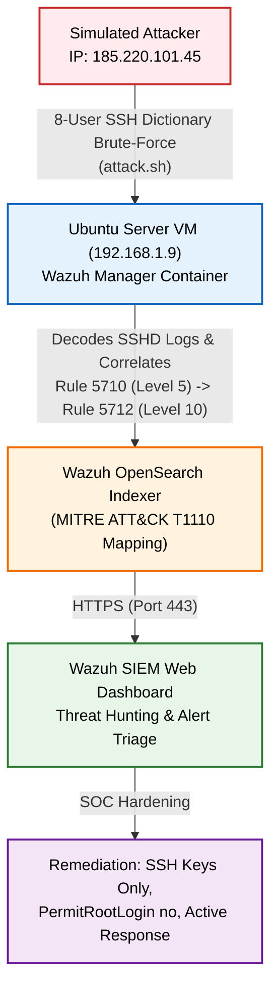
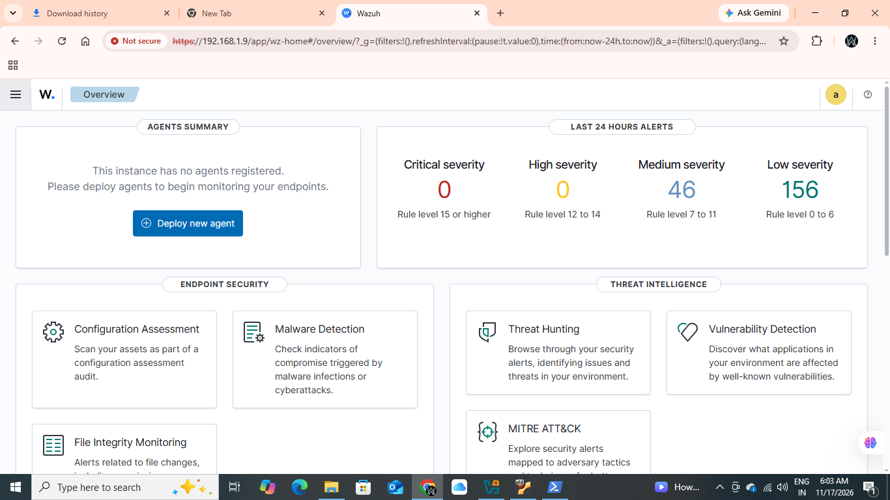
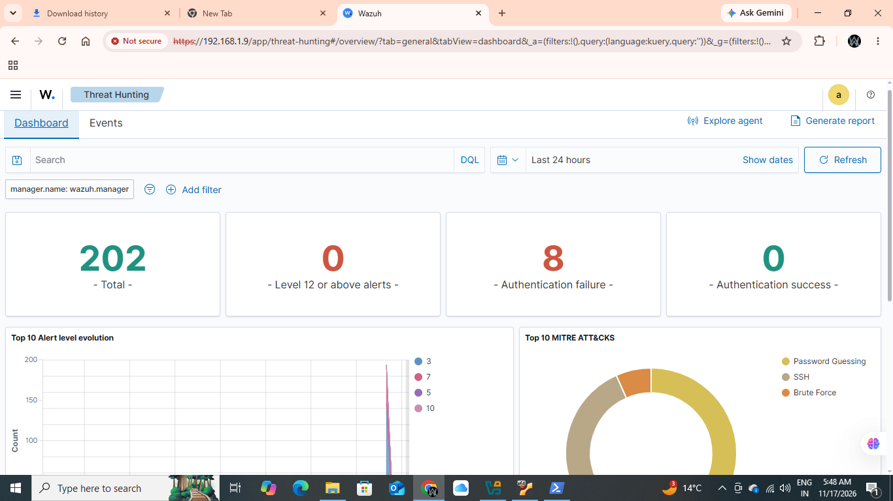
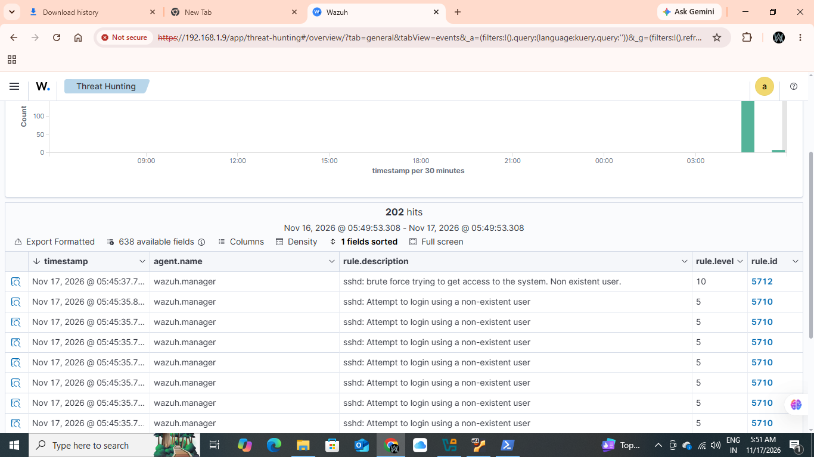

# Enterprise SIEM & XDR Home Lab (Wazuh 4.11.2)

A self-hosted **Security Information and Event Management (SIEM)** and **Extended Detection and Response (XDR)** home lab deployed with **Wazuh v4.11.2**, **Docker Compose**, and **Ubuntu Server**. This project demonstrates end-to-end log ingestion, SSH dictionary brute-force simulation, correlation rule engineering, and **MITRE ATT&CK** threat mapping.

## Architecture & Data Flow

## Tech Stack & Environment

* **SIEM / XDR Engine:** Wazuh v4.11.2 (Wazuh Manager, OpenSearch Indexer, Wazuh Dashboard)
* **Containerization:** Docker Engine & Docker Compose (`single-node` deployment)
* **Host Infrastructure:** Isolated Ubuntu Server VM (`192.168.1.9`, 4 GB RAM) on Oracle VirtualBox (Bridged Networking)
* **Security Frameworks:** MITRE ATT&CK (`T1110`), Syslog / SSHD Rule Correlation (`Rules 5710 & 5712`)

## Attack Simulation & Detection Engineering

Executed [`attack.sh`](attack.sh) to simulate an **8-user SSH dictionary brute-force attack** (`root`, `admin`, `ubuntu`, `oracle`, `postgres`, `test`, `deploy`, `backup`) from external IP `185.220.101.45`:

* **Individual Failed Logins (`Rule ID: 5710`, Level 5):** Captured all 8 authentication attempts against non-existent accounts.
* **Correlated Brute-Force Alert (`Rule ID: 5712`, Level 10):** Automatically escalated the rapid authentication failures into a high-severity correlation alert (*"sshd: brute force trying to get access to the system. Non existent user"*).
* **MITRE ATT&CK Mapping:** Categorized under **Credential Access — Brute Force (`T1110`)**, **Password Guessing (`T1110.001`)**, and **SSH**.

## Lab Screenshots

### 1. Wazuh SIEM Overview Dashboard

### 2. Threat Hunting & MITRE ATT&CK Mapping (`Authentication failure: 8`)

### 3. Correlated SSH Brute-Force Alert Triage (`Rule 5712` & `Rule 5710`)

## Remediation & Hardening Recommendations

* **Enforce SSH Key Authentication:** Set `PasswordAuthentication no` in `/etc/ssh/sshd_config`.
* **Enable Active Response:** Configure Wazuh `firewall-drop` to automatically block IPs triggering `Rule 5712`.
* **Restrict Root Login:** Set `PermitRootLogin no` and enforce least-privilege access controls.
